# Tesseract VP

**An HDR video processor for the Fire TV Cube (3rd generation).**

Tesseract VP turns a Fire TV Cube into a video processor that sits between your sources and your screen. It tone maps every HDR picture to your display's real brightness, frame by frame. That covers the streaming apps (Netflix and Disney+ included), Kodi and the Cube's HDMI input. It is built for projectors and other displays that can't reach HDR brightness. It also gives you full control of the signal and sound that leave the box: output format, frame rate, aspect and masking, calibration and lossless audio.

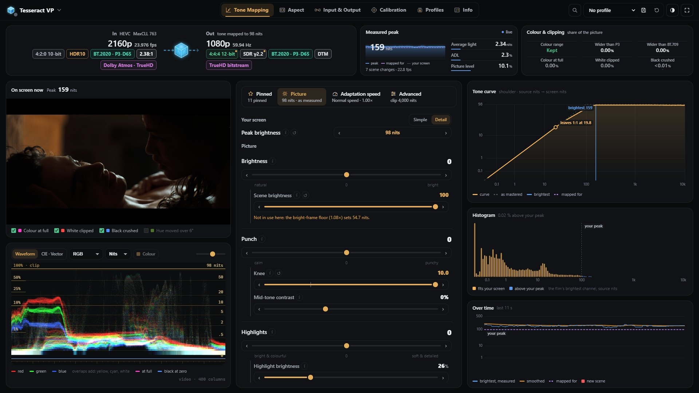

*The control page, open in any browser on your network.*

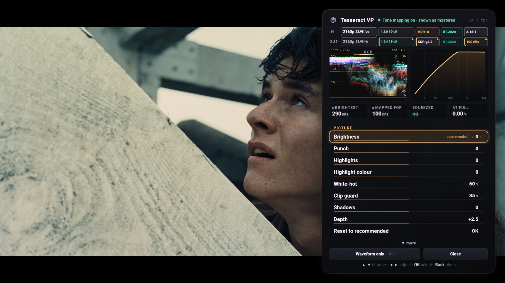

*The on-screen menu during a 4K HDR10 film, captured from the projector's input.*

This repository holds Tesseract VP's **signed releases**, its [roadmap](ROADMAP.md) and the [wiki](https://github.com/Javbomb/tesseract-vp/wiki). Installed Cubes update themselves from here.

**[Download Tesseract VP Setup for Windows](https://github.com/Javbomb/tesseract-vp/releases/download/stable/Tesseract-VP-Setup.exe)** · [Website](https://javbomb.github.io/tesseract-vp/) · [DTM compare](https://javbomb.github.io/tesseract-vp/compare/) · [Upscaling compare](https://javbomb.github.io/tesseract-vp/upscaling/) · [UI demo](https://javbomb.github.io/tesseract-vp/demo/) · [HDMI output test](https://javbomb.github.io/tesseract-vp/hdmi-test/) · [All releases](https://github.com/Javbomb/tesseract-vp/releases) · [Install](#installing) · [Wiki](https://github.com/Javbomb/tesseract-vp/wiki)

> **Testers wanted.** The first Stable release, **20261126**, is out. If you have an unlocked Fire TV Cube (3rd generation), please try it and tell us how it goes: the wiki's [Testing guide](https://github.com/Javbomb/tesseract-vp/wiki/Testing-guide) lists what to try, and problems go in [Issues](https://github.com/Javbomb/tesseract-vp/issues/new/choose).

---

> **[▶ UI demo: try the Tesseract VP control page in your browser](https://javbomb.github.io/tesseract-vp/demo/)**: the real page running on a simulated Cube, with film pictures tone mapped in advance. Change the aspect, masking, geometry, output and picture settings and watch the picture, scopes and signal cards respond. Nothing is sent anywhere.

## What it does

### Dynamic tone mapping

> **[▶ DTM compare: flip Tesseract VP frame by frame against another popular DTM solution](https://javbomb.github.io/tesseract-vp/compare/)**: real 4K HDR film frames, both rendered for a 100-nit projector, with waveforms. Click or press Space to switch.

> **[▶ HDMI output test: what the Cube actually sends, measured with a capture card](https://javbomb.github.io/tesseract-vp/hdmi-test/)**: bit depth, dither, colour and the HDMI input, with every test picture and the counts behind each result.

- **Every frame is measured and gets its own curve.** Each picture is fitted to your screen's real peak brightness.
- **1:1 wherever it can be.** A scene that fits your screen is shown 1:1, as mastered. One that doesn't is compressed to fit, as gently as possible: as much of the picture as it can stays 1:1, and the rest, mid-tones included when the scene is far brighter than your screen, is brought down smoothly. Highlights roll off smoothly toward your screen's peak instead of hard clipping, the curve moves gently between scenes, and colours are held to their hue as they are brought in.
- **Highlights and shadows with room to breathe.** Bright highlights keep their shape right up to your screen's peak. Deep shadows stay deep, and in bright scenes the shadow detail is kept.
- **Subtitles left out.** Burned-in white or yellow subtitles at the bottom of the picture, and in the bars, don't count towards the scene's brightness, so they don't dim the film.
- **Look-ahead.** Films are measured several frames before they are shown, so a scene cut gets the right curve on the frame it happens. Small, bright highlights are caught too.
- **Protected streams included.** Netflix, Disney+ and other DRM video can't be read by software. Tesseract VP measures them in the video hardware instead, ahead of the screen. On a Disney+ 4K film, 99.5 % of frames reached the screen with their own curve, with 4K kept and no protection errors.
- **HDR10, HDR10+ and Dolby Vision titles.** HDR10+ films get the same tone mapping as HDR10. For Dolby Vision titles, from the streaming apps and Kodi, you choose:
  - Tesseract VP's tone mapping of the HDR10 base;
  - **LLDV:** Dolby's own processing, finished by Tesseract VP's tone mapping;
  - Dolby Vision out to a Dolby Vision display.
- **Dolby Vision FEL.** Full-enhancement-layer films are rebuilt to their full 12-bit picture by signde's Kodi FEL, built on djnice's FEL work, then sent as Dolby Vision or tone mapped by Tesseract VP. Setup can download Kodi FEL straight from signde's GitHub and copy your Kodi library into it. signde's other FEL players (VLC FEL, a Jellyfin client) use the same helper but aren't tested with the VP yet.
- **SDR or HDR10 out.** Send the tone-mapped picture as SDR, or as HDR10 aimed at your display's peak, with the menus and subtitles converted in at the right brightness.
- **Controls you can tune live:**
  - Brightness, Punch, Highlights, Highlight colour, Shadows, Depth, White-hot and Clip guard, with the tuned setting in the middle of each;
  - Scene brightness and adaptation speed;
  - an auto black floor for films mastered with raised blacks.

  Every change ramps in smoothly, with no flicker.

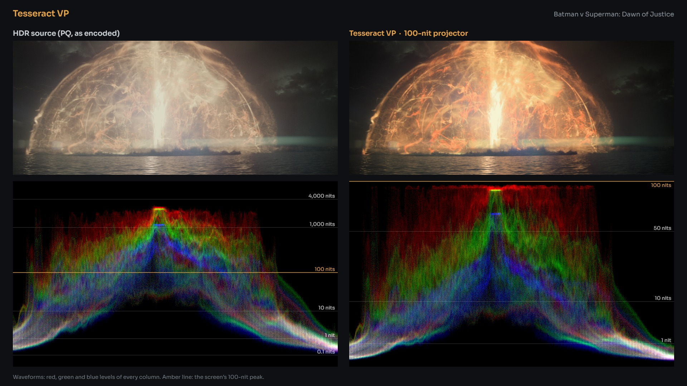

<p>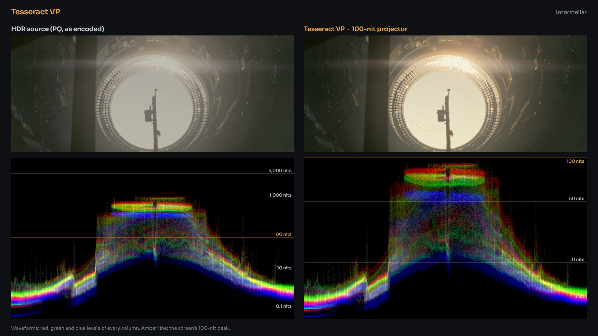 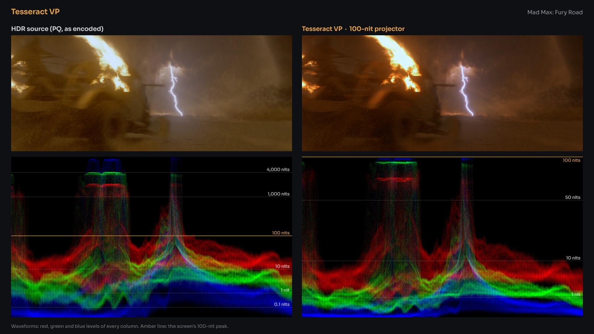</p>
<p>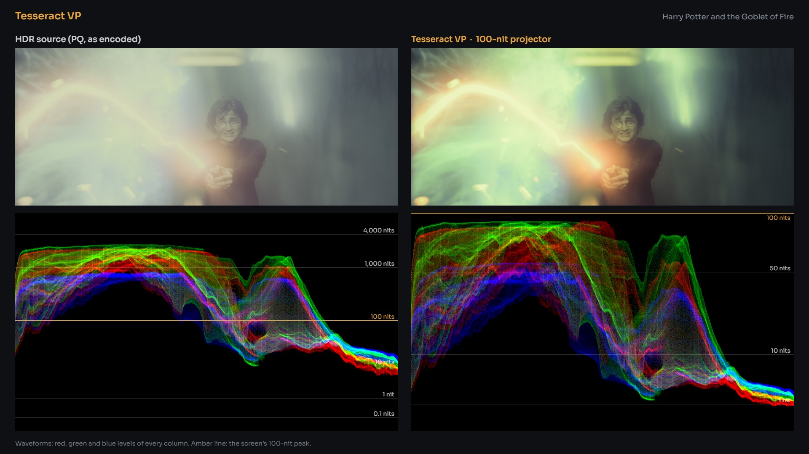 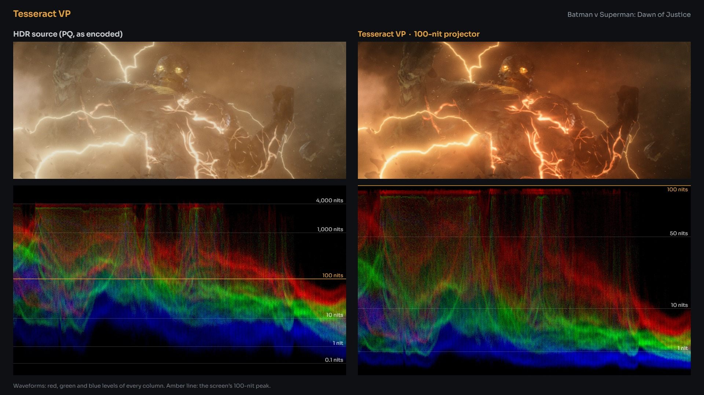</p>
<p>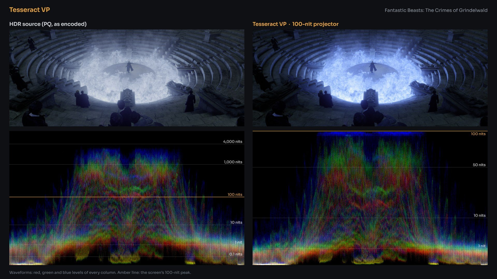 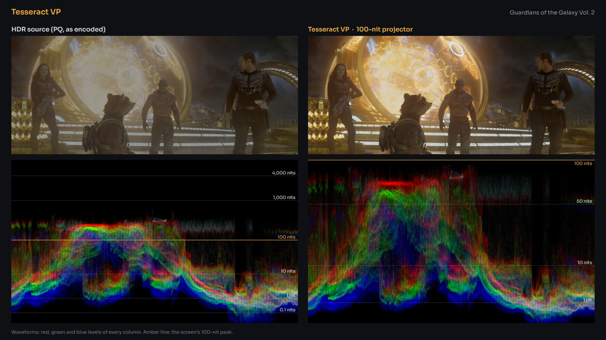</p>
<p>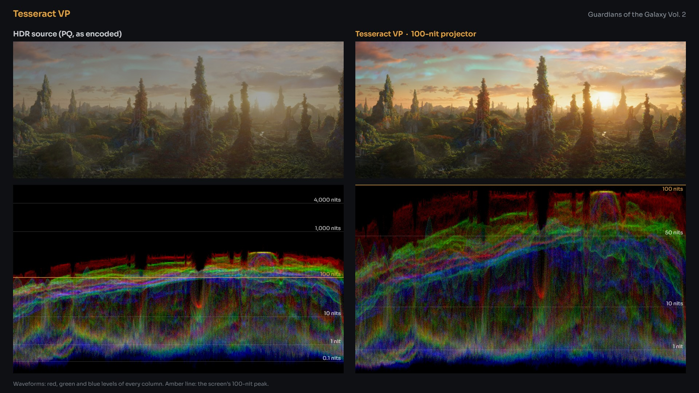 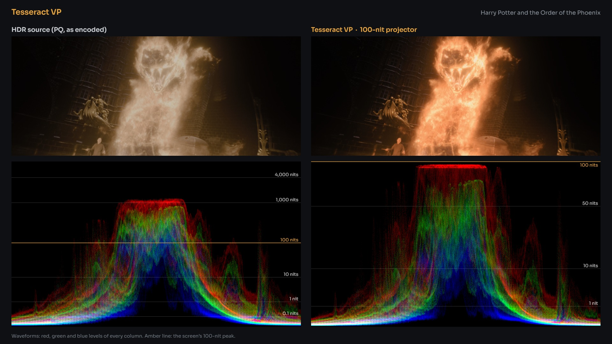</p>
<p>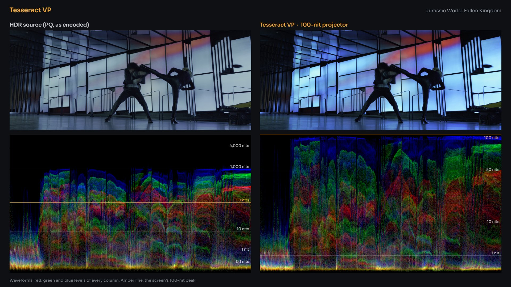 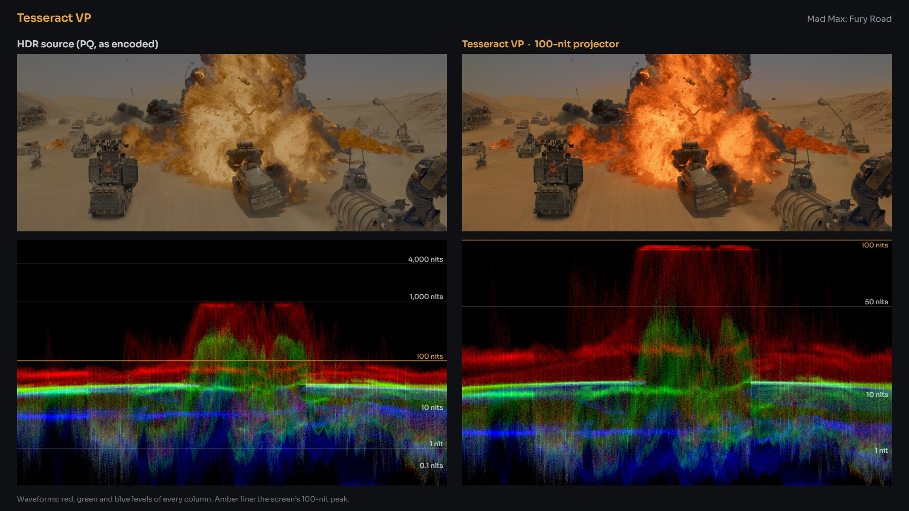</p>
<p>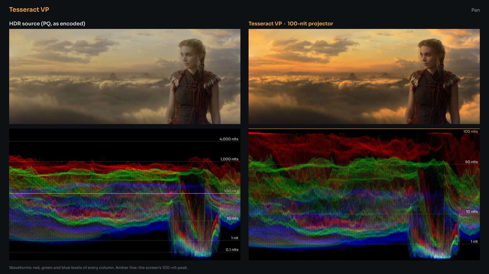 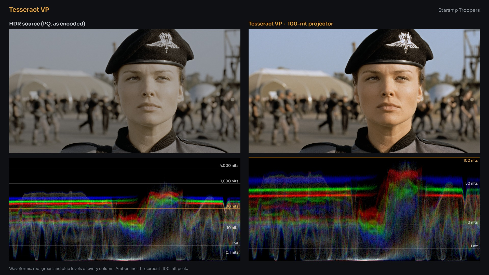</p>
<p>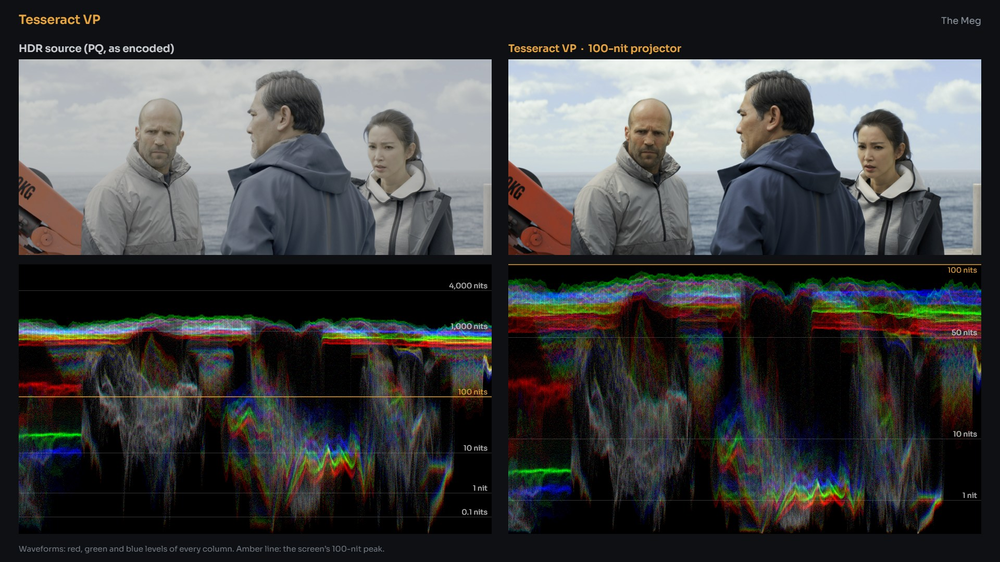 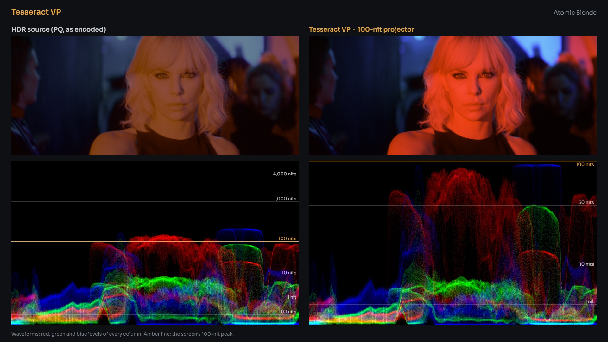</p>
<p>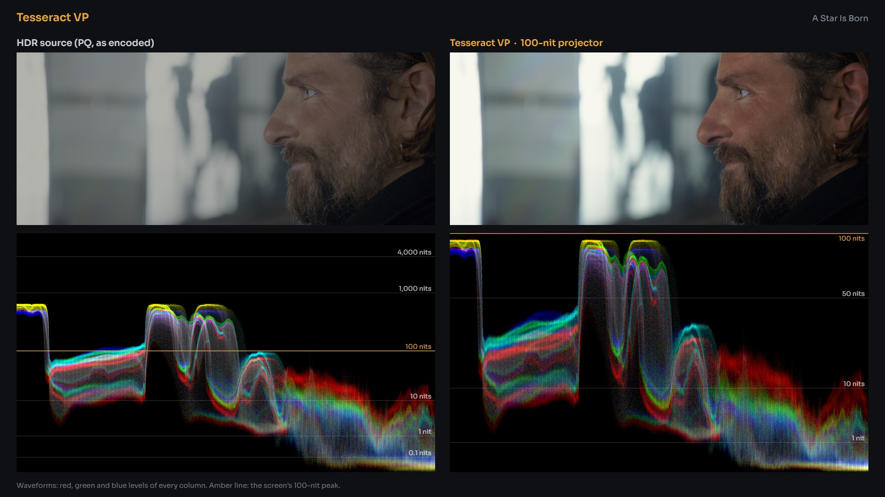 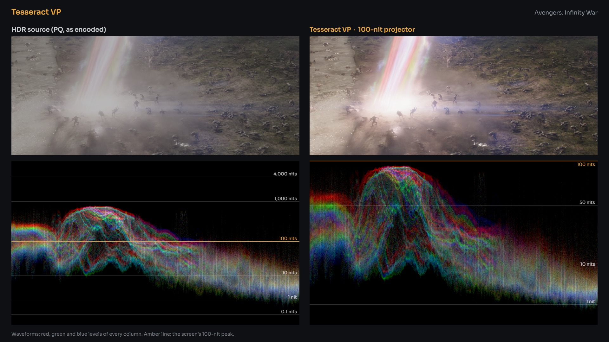</p>

*Each card: the HDR source as encoded (left) and Tesseract VP for a 100-nit projector (right), with their waveforms. Films: Batman v Superman: Dawn of Justice (fireball dome over water); Interstellar (sunlight through a round window); Mad Max: Fury Road (sandstorm with fire and lightning); Harry Potter and the Goblet of Fire (green spell light); Batman v Superman: Dawn of Justice (red lightning); Fantastic Beasts: The Crimes of Grindelwald (blue fire in the amphitheatre); Guardians of the Galaxy Vol. 2 (golden glow); Guardians of the Galaxy Vol. 2 (sunset over an alien forest); Harry Potter and the Order of the Phoenix (fire in the dark); Jurassic World: Fallen Kingdom (fight against video screens); Mad Max: Fury Road (explosion in the desert); Pan (sunset over the clouds); Starship Troopers (troopers under a bright sky); The Meg (daylight at sea); Atomic Blonde (neon-lit face); A Star Is Born (window light on a face); Avengers: Infinity War (beam of light from the sky).*

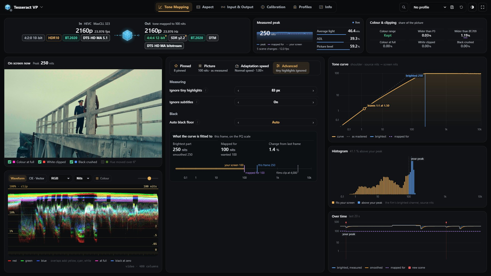

### Games and the HDMI input
- **HDR10 consoles, tone mapped live.** An Xbox on the HDMI input gets a curve made from each of its own frames.
- **Low latency.**
  - About **7 ms** from a frame's arrival to the screen in game mode, against 41 ms without it.
  - **Auto low latency (ALLM)** switches to game mode when the console asks.
- **Genlock.** The output follows the source's timing, so frames aren't dropped or repeated once it has locked.
- **EDID builder.** You choose what the source is told about your screen: resolutions, refresh rates, HDR formats, peak and black, and bit depth. Your receiver's sound formats and Atmos pass through untouched.

### Output
- **Frame-rate matching.** Each film plays at its own rate, and 23.976 and 24.000 are told apart. Streaming apps are included, with the sound kept, Atmos too.
  - The switch waits until the app's protection sees the HDMI link secure again, so Disney+ and the others switch even through an AV receiver.
  - Netflix switches where the HDMI handshake is quick. Through slower receivers it stays at the usual rate by itself, or you can choose **Always try** or **24p at launch**.
- **Full control of the signal:**
  - colour format (4:4:4, 4:2:2, 4:2:0 or RGB);
  - bit depth and resolution;
  - refresh rate;
  - colour space (BT.2020 or BT.709);
  - Limited or Full range.

  Anything a mode can't carry is lowered automatically to what HDMI 2.0 and your display support.
- **Colour.** Keep your display in BT.2020, and menus, SDR and console pictures are converted in so they don't look oversaturated. Or use a BT.709 display, and films' wider colours are mapped in along constant hue instead of being clipped.
- **Upscaling and chroma.**
  - A choice of hardware upscalers for 1080p and smaller pictures, Lanczos 4 by default.
  - Smooth chroma upsampling for 4K films.

  Both run in the video hardware, with almost no CPU cost.
- **Custom 4K upscaler for Kodi (in Nightly, off by default).** Tesseract VP's own GPU upscaler takes Kodi's 1080p SDR films to 4K. Each new pixel stays within the range of the source pixels around it, so it adds no ringing. Edge steps add edge anti-aliasing and steepening, and the colour goes from 4:2:0 straight to 4K. It fits as many steps as each frame rate allows; everything else keeps the hardware scaler.

  > **[▶ Upscaling compare: blink the 4K upscaler against the usual scalers and the 4K original](https://javbomb.github.io/tesseract-vp/upscaling/)** on 14 film frames.
- **Colour upgrade, sharpening and debanding for Kodi.** Kodi's 8-bit SDR films up to 1080p get full 4:4:4 colour, rebuilt on the Cube's GPU, with optional sharpening and debanding.
- **Downscaling:** Sharp, Balanced or Soft, for sources such as the HDMI input.

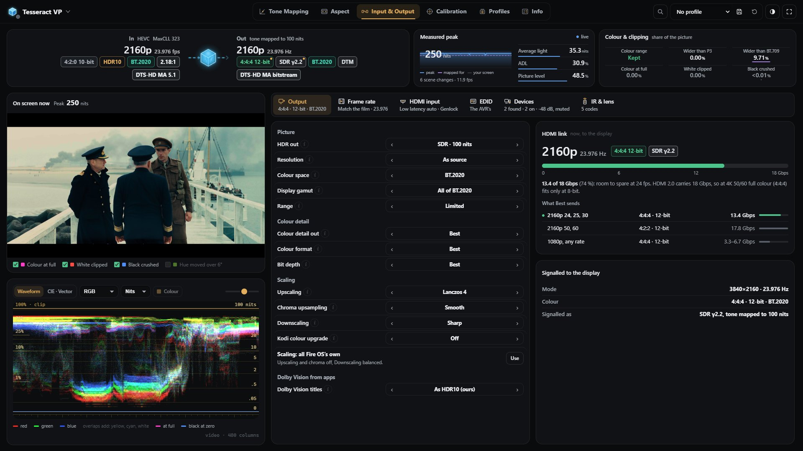

### Aspect, masking and subtitles
- **Black bar detection in every source:** apps, Kodi, the HDMI input, protected streams and Dolby Vision, FEL included. A film that changes shape (an IMAX scene) is followed on the frame it changes.
- **Fit the picture to your screen:**
  - fill;
  - picture to the top or bottom;
  - anamorphic lenses (1.25, 1.33 and 1.5x), with non-linear stretch for 16:9;
  - scope zoom for 2.35, 2.37 and 2.40 screens;
  - masking for each edge.
- **Subtitles kept in view.** Burned-in subtitles in a bar are recognised, and Fill keeps just enough of that bar to show them.
- **Lens memory.** When the film's shape changes, the projector's own lens memory is recalled, on projectors Tesseract VP can control over the network.

### Sound
- **Lossless audio, built in.** Dolby TrueHD Atmos, DTS-HD Master Audio and DTS:X go to your receiver untouched, bitstreamed, with no extra module to install. Dolby Atmos from Netflix and Disney+ reaches your receiver as Atmos. Tesseract VP's own audio module, [open source under MIT](audio), with thanks to signde, whose Fire TV AV research showed how it could be done on the Cube 3.
- **What's playing, on the page.** The signal card shows the sound format going out: codec, channels, Atmos or DTS:X.

### Calibration
- **Fine controls in the output**, held for every source and the menus:
  - black level, white level and gamma;
  - red, green and blue gain and offset.

  Their steps are finer than most displays' own controls.
- **3D LUT and greyscale.** Upload a 3D LUT and a greyscale and gamma table for each calibration set.
- **Gamut guardrail.** Colours held inside BT.709, DCI-P3, BT.2020 or your display's measured primaries.
- **Calibration software (in testing).** The Cube speaks the network pattern protocols that calibration software uses (Resolve, PGenerator and UPGCI), for Calman, HCFR, DisplayCAL and ColourSpace. Checked with protocol test tools; not yet confirmed with each program.
- **Separate SDR and HDR calibration**, each picked by what is playing.
- **Built-in test patterns:** ramps, windows, average-light patches and single-pixel 4K checks, in SDR and HDR, shown tone mapped or untouched.

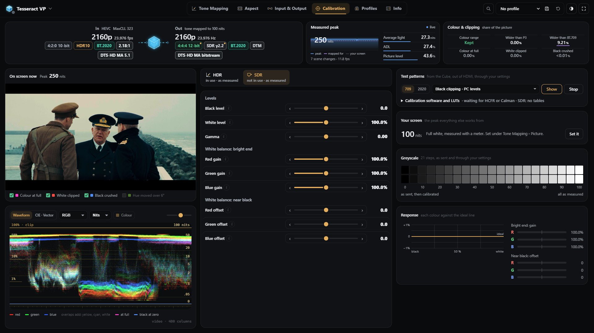

### Control
- **Control page.** Every setting is one line, with the live picture (menus and subtitles included), waveform and tone curve kept in view, so you see each change as you make it.
- **Other ways in:**
  - an on-screen menu on the Fire TV remote;
  - a full-screen settings page on the Cube itself;
  - a phone app that finds every Tesseract VP on your Wi-Fi, with **one-tap scenes**: Movie night wakes the projector and amp, picks the input and dims the lights; Off puts it all to sleep. From the app, a home-screen widget or a quick-settings tile.
  - **Problem alerts**, if you want them: one quiet notification when an update didn't install, a version was rolled back, or a Cube restarted unexpectedly or stopped answering.
- **Profiles with automatic rules.** Game, HDMI, Film, Video and SDR each load their own preset when the source changes.
- **HDMI-CEC for every device.** Your HDMI chain in signal order, with each device's power, name and input, and the amp's volume. One press of the remote's power button wakes or sleeps the projector or TV and the amp with the Cube.
- **Nothing wakes by itself.** Your projector and amp turn on when you press the remote or run a scene, never because the Cube woke up on its own.
- **IR.** Learn any IR remote's buttons and tie them to what plays: lights off when a film starts, back on when it stops.
- **API and webhooks.** Events for Home Assistant or anything else as the source, HDR type, output mode or picture shape changes.
- **Its own launcher**: a home screen with the glowing cube, your HDMI devices, your own apps, a Last played strip and one place for all the settings.
- **Several Cubes.** Switch between every Tesseract VP on your network from the control page.

<p>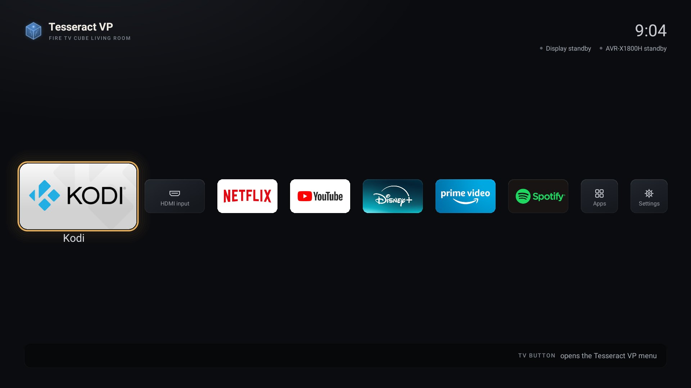 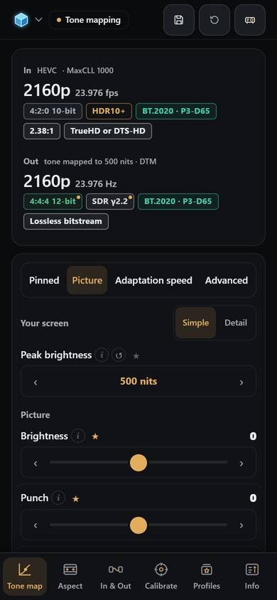</p>
<p>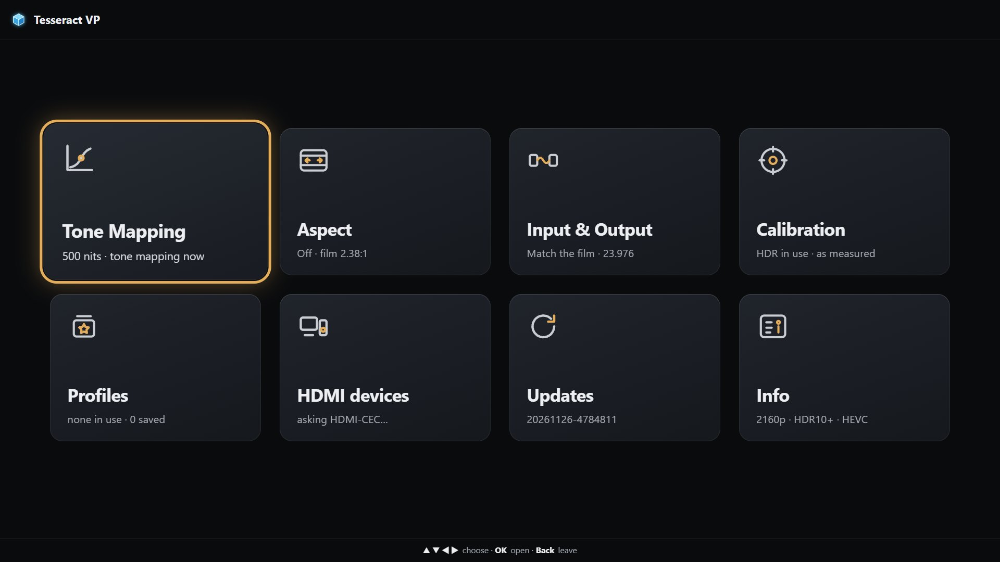</p>

*The launcher, the control page on a phone, and the settings page on the Cube itself.*

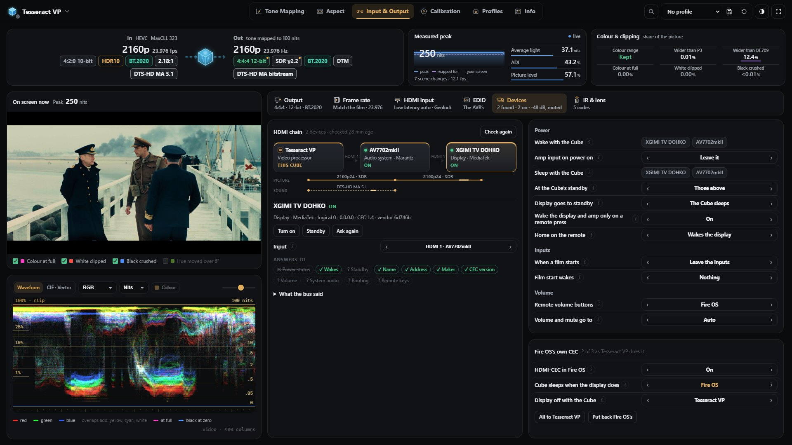

### Safe to run
- **Signed releases.** A Cube refuses any update whose signature or checksums don't match.
- **Roll back** any update in one step.
- **Watchdog.** If a new version keeps failing, the watchdog puts the previous one back.
- **Backup and restore** of every setting, preset and profile.
- **Light on the CPU.** Most of the processing runs in the Cube's video hardware, so the CPU stays mostly free while a film plays.

---

## Requirements

- A **Fire TV Cube, 3rd generation** (model AFTGAZL), **unlocked and rooted** (Magisk). Tesseract VP Setup can run the community unlock for you, or install straight onto a Cube that is already rooted.
  - The unlock only works on firmware up to the version it was made for, so prepare a new Cube before it ever updates.
  - The unlock itself is a third-party tool and is not included in Tesseract VP.
- A Windows 10 or 11 PC for **Tesseract VP Setup**. On a Mac or Linux, the installer is one command.
- ADB debugging turned on on the Cube (**Settings › My Fire TV › Developer options**). Setup downloads Google's Android platform-tools for you the first time it opens.

## Installing

1. Download **[Tesseract-VP-Setup.exe](https://github.com/Javbomb/tesseract-vp/releases/download/stable/Tesseract-VP-Setup.exe)** and run it. It installs for your Windows account only, with no administrator prompt, and adds Tesseract VP Setup to the Start menu.
   - Windows may say it "protected your PC" because the installer is new. Choose **More info › Run anyway**.
2. Tesseract VP Setup opens. The first time, it offers to download Google's platform-tools (about 8 MB), which it needs to talk to a Cube.
3. Press **Find Cubes** (or type the Cube's address), then follow the large first button. It backs up the Cube, unlocks it if needed and installs, showing each step as it runs.
4. Open the control page at `http://<cube>:8090/`.

Or paste one line into PowerShell, which downloads and installs the same thing and opens Setup:

```powershell
irm https://github.com/Javbomb/tesseract-vp/releases/download/stable/go.ps1 | iex
```

Backups are kept in **Documents › Tesseract VP › backups**. To remove Tesseract VP Setup from the PC, use **Settings › Apps** like any other program; your Cubes keep running.

**Phone app (Android):** on the phone, open **[Tesseract-VP-Remote.apk](https://github.com/Javbomb/tesseract-vp/releases/download/stable/Tesseract-VP-Remote.apk)**, allow your browser to install apps when Android asks, and install it. On the same Wi-Fi it finds every Tesseract VP by itself.

**Mac or Linux, or by hand:** download `tesseract-vp.zip` from the [latest release](https://github.com/Javbomb/tesseract-vp/releases), unzip it and run `install.sh <cube-address>`. The package's own `README.md` describes every step.

## Releases

- **stable**: tested releases. The current one is **20261126** (updated the same day with subtitle-aware measurement and new picture defaults) ([release notes](https://github.com/Javbomb/tesseract-vp/releases/tag/stable)). A Cube checks for these once a day and tells you when one is ready. It doesn't install one by itself.
- **nightly**: the newest builds, checked only when you ask.

## Updating a Cube

On the control page, open **Profiles › Updates**, choose Stable or Nightly, then press **Check now** and **Update**. You can do the same:

- from the Cube's own **Settings › Tesseract VP** page;
- from Tesseract VP Setup's **Manage › Check for updates**.

Updates keep the parts you installed up to date too, such as Dolby Vision FEL and lossless audio.

## Roadmap

**Live now:** everything above.

**Next:**
- Netflix at its own frame rate through more receivers, set before the film starts.
- A dynamic contrast guard for displays that dim in dark scenes.

**Then:**
- The custom 4K upscaler for Kodi out of testing, then for the HDMI input.
- Sharpening and debanding beyond Kodi, once the hardware can run them at full quality.
- Two-projector stacking.

The full plan, item by item, is in **[ROADMAP.md](ROADMAP.md)**.

## Help and feedback

- **[Wiki](https://github.com/Javbomb/tesseract-vp/wiki)**: installing, your first film, every page of the control page, troubleshooting and known issues.
- **[Issues](https://github.com/Javbomb/tesseract-vp/issues/new/choose)**: report a problem or suggest something. Please include the version, your display and receiver, and what was playing.


## Credits

Tesseract VP stands on the work of others in the Fire TV Cube community:

- **Pro-me3us** and the XDA community behind the Cube 3 unlock, Magisk and TWRP, which Tesseract VP needs. Setup runs their unlock from [their XDA guide](https://xdaforums.com/t/unlock-magisk-twrp-firetv-3nd-gen-cube-gazelle-ps7718.4800530/); it isn't part of this project.
- **djnice** for the Dolby Vision FEL work (vlc-fel-android), and **signde** for porting it to the Cube 3. Tesseract VP ships their FEL kernel helper (`dvfel.ko`) built unchanged from signde's [firetv-passthrough](https://github.com/signde/firetv-passthrough) under the GPL; its source and licence are in each release's module source zip.
- **signde** for [Kodi FEL](https://github.com/signde/xbmc/releases): Setup can download it straight from signde's release and install it. VLC FEL and Wholphin FEL are signde's FEL players too.
- **signde** for Fire TV AV, whose research into HDMI audio passthrough on the Cube 3 pointed the way for Tesseract VP's own lossless audio module: that Fire OS keeps dropping the HDMI format out of passthrough so it has to be held there, and how the voice DSP reference needs handling. The module's code is separate (a wrapper in front of the stock audio HAL, with IEC 61937 packing written from the standard) and [open source under MIT](audio). If Fire TV AV is installed, Tesseract VP's audio module switches it off (and keeps a backup), as both steer the same thing.

## Source

The kernel modules Tesseract VP installs on the Cube are open source under the GPL. Their complete source, with build instructions, is attached to each release as **tesseract-vp-module-source.zip** ([Stable](https://github.com/Javbomb/tesseract-vp/releases/tag/stable)). The lossless audio module is open source under the MIT licence, in the [audio](audio) folder. The rest of Tesseract VP is separate software and isn't covered by those licences. It is free to use, and will stay free, but it isn't open source. See [LICENSE.md](LICENSE.md).

---

Tesseract VP is an independent project. It is not affiliated with or endorsed by Amazon or Dolby. Fire TV is a trademark of Amazon; Dolby, Dolby Vision and Dolby Atmos are trademarks of Dolby Laboratories; DTS and DTS:X are trademarks of DTS, Inc. Calman, ColourSpace, DisplayCAL and HCFR belong to their owners. Unlocking a Fire TV Cube is at your own risk and may void its warranty.
